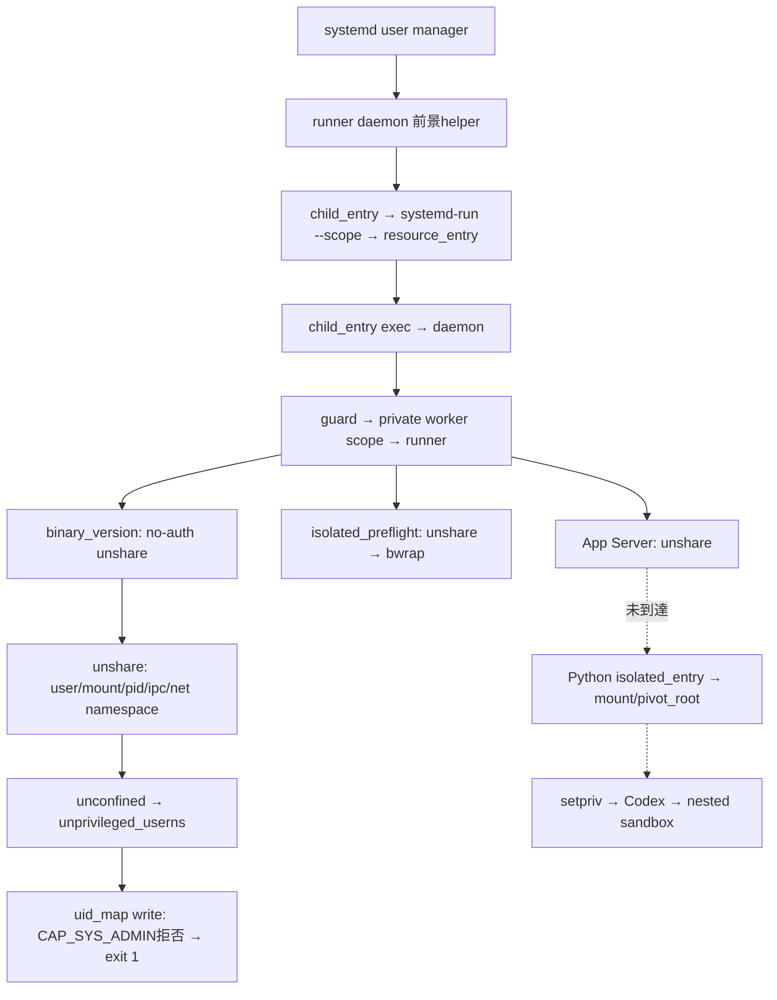
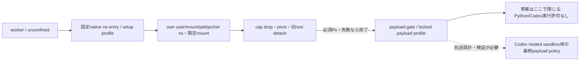

# AppArmor専用ポリシー設計・レビュー — Phase 2-E3.1

調査日: 2026-10-28〜29（Asia/Tokyo）。開始commit: `35a56c786396ab4540d308e14820d7b0adbf8803`。
**設計レビュー用。適用禁止。今回はprofileロード、ホスト設定変更、実サービス起動を実施していない。**
本書はAIによる調査・静的レビューの記録。実測、ソースでの確認、提案、未検証を分ける。

## 結論とレビュー対象

`userns,`だけの追加や、専用パスにPython/unshareを置く方法は採用しない。
案Aの**非特権・固定native entrypoint＋setup/payloadの権限分離**を条件付きの設計候補とする。
ただし、現行起動経路をそのまま動かせる完成済みポリシーは得られていない。
特にCodex/bwrapの入れ子namespaceと、payloadへsetup権限を継承させない設計の両立が未解決である。
この条件を無視してcapability/mountを広く許可したり、no_new_privsを外したりしない。
案Bは既存profile・起動モデルを変更しない条件では成立を確認できず、現時点では不採用。

[専用profile草案](../systemd/apparmor/agent-orchestrator-noauth.draft)を追加した。
これは**固定no-auth fixtureのsetupと閉じたpayload境界のモデル**であり、Python/Codexの実行許可は含まない。
不足を広い許可で埋める代わりに停止する草案で、今回の2失敗を解消したとは扱わない。
専用native entrypoint自体も未実装である。ホストへの導入承認を求める段階ではない。

今回の変更は文書と草案だけ。runner、daemon、unit、既存163テストには手を加えていない。
E3の確定結果は旧148成功、新規15件中13成功・2失敗、合計161成功・2失敗のまま。
本工程ではサービス起動を伴うテストを再実行していない。skipやassert変更による成功扱いもしていない。

## 調査対象と証拠

| 項目 | 確認結果 |
| --- | --- |
| 実kernel | `7.0.0-38-generic`、package `7.0.0-38.38` |
| AppArmor parser | `5.0.2-0ubuntu1~26.04.1` |
| util-linux | `2.41.3-3ubuntu2.2`、unshareはroot所有・非setuid |
| bubblewrap | `0.11.1-1ubuntu0.3`、bwrapはroot所有・非setuid |
| libc | `2.43-2ubuntu2.4`。clone3の実使用は未トレース |
| kernel機能 | USER_NS/PID_NS/NET_NS/IPC_NS、AppArmor、seccompが有効 |
| 実効制約 | `apparmor_restrict_unprivileged_userns=1`、`apparmor_restrict_unprivileged_unconfined=1` |
| securityfs | userns_create、mount/umount/pivot_root、stack/change_profileを広告 |
| IDE由来の調査process | `/proc/self/attr/current = snap.code.code (complain)` |
| E3のsystemd最小probe | `unconfined`から`unprivileged_userns`へ遷移し、同一PIDでcapability拒否 |

現在のkernelに対応するUbuntu公式tag `Ubuntu-7.0.0-38.38`のソースと、公式archiveの同版`.dsc`を取得した。
.dscのVcs-Gitもresoluteの同リポジトリを指す。ソースと実行kernelを再ビルドして同一性を証明したものではない。
util-linux/bwrap/parserは対応するupstream版を参照した。Ubuntu差分すべての照合は未実施。
libcのupstreamタグからの対象ファイル取得は404となり、実clone3採否を推定で確定していない。

原資料は`.runtime/phase2-e3-1-evidence/`に保存し、Gitへは含めない。
E3原証拠は変更せず、以下を参照した。

- `phase2-e3-evidence/usernamespace-diagnostic-correlated.json`
- `phase2-e3-evidence/test_systemd_sigterm_cancels_running_tasks_and_releases_scopes.json`
- `phase2-e3-evidence/test_systemd_sigkill_restarts_and_reconciles_without_replay.json`
- `phase2-e3-evidence/full-tests.txt`、fixture unit journal。

認証情報は参照していない。以下の認証mountの説明はソースの静的調査であり、ファイル内容の読取りではない。

## 現在のプロセス・profile遷移

以下は**実装から再構成した経路**。全プロセスを同時に観測した図ではない。
E3で同一PIDに対応付けたprofile遷移の実測は、専用最小unshare probeのもの。
worker経路にも同じunshare設定とuid_map失敗が記録されているが、個々のworkerについて全profileを採取してはいない。



`resources.Control.wrap`は`systemd-run --user --scope`で子の資源を制限する。
scopeは呼出し側が生成したprocessを収容し、cgroupの移動そのものはAppArmor labelを付け替えない。
serviceはuser manager側から起動するため、IDE由来のprofileを継承する前景実行とは異なる。
`child_entry.py`はPR_SET_PDEATHSIGとexec、`resource_entry.py`はscope値確認と子process監督を担当し、namespaceを生成しない。
主な参照: `src/daemon.py` foreground/start_worker、`src/resources.py` Control.wrap、`src/transport.py` Process。

### syscall・操作の所在

| 操作 | 実装で確認した使用箇所 | 証拠の範囲 |
| --- | --- | --- |
| unshare | `isolation.isolated_launch`が`/usr/bin/unshare --user --map-root-user --mount --pid --ipc --fork --mount-proc`を生成。no-authだけ`--net`追加 | 現行source＋E3失敗argv。認証実行は外側でnet namespaceを作るとは限らない |
| legacy unshare | `isolation.launch`→`ns_entry.py`。旧単一workspace/identity系にも残る | 静的確認。新案でこの経路を未対応のままfallbackさせない |
| clone/fork | unshare upstream `unshare.c`はunshare syscall後、`--fork`でfork。bwrapは`raw_clone(CLONE_NEWNS / NEWUSER / NEWPID / NEWNET ...)` | 対応版source。新規のsyscall traceは未実施 |
| clone3 | repoに直接呼出しなし。Python subprocess/libc/backendやCodex内部で使われる可能性 | 実使用未検証。cloneの存在だけでclone3不使用と断定しない |
| uid_map | unshare `map_id`→`/proc/self/uid_map`へ自UIDの1行map | E3 stderr＋upstream版source |
| gid_map/setgroups | unshareは`setgroups`へdenyを書いてからgid_mapを作る。bwrapもmap設定処理を持つ | E3ではuid_mapより後へ到達した証拠なし |
| mount/pivot_root/umount2 | `isolated_entry.py`のtmpfs/bind/ro remount/private化、ctypes pivot_root、MNT_DETACH | 実装確認。今回のsystemd失敗より後の操作であり許可の実測なし |
| capability操作 | setprivはbounding setをsetuid/setgid/setfcap以外drop。入れ子usernsでは再びcapabilityを得る場合がある | 現行source。bounding set dropだけで入れ子mount不能とは一般化しない |
| bwrap sandbox | `isolated_preflight`、verification、Codex側sandbox | 外側profileからの継承・stackを別途評価する必要あり |

## 拒否原因とkernelの適用条件

E3の最小probe PID 3038865ではuser namespace生成そのものが失敗したのではなく、
`unconfined → unprivileged_userns`の遷移後、uid_map書込みで`capname=sys_admin`が拒否された。
現在の`/etc/apparmor.d/unprivileged_userns`も`userns`を許可する一方、capabilityとchange_profileをaudit denyし、
子のexecをprofileへstackする。既存profileは変更しない。

kernelの`apparmor_userns_create`は`security_create_user_ns`から呼ばれ、新しいcredへlabelを設定する。
`task.c:aa_profile_ns_perm`では、既定unconfined・userns restriction有効・既存namespaceで必要capabilityなしの場合、
`unprivileged_userns`への遷移が組み込まれている。profileがnamespace classをmediationする場合はそのpolicyを評価する。
古いABIや非mediation経路による暗黙許可を利用せず、草案はABI 5.0で`userns create`を明示した。

**uid_map拒否との直接対応:** 対象kernelの`kernel/user_namespace.c:map_write`は、UID/GID mapの書込みについて
`file_ns_capable(file, map_ns, CAP_SYS_ADMIN)`を確認する。このチェックとAppArmorのcapability denyがE3の記録に整合する。
[対象kernel user_namespace.c](https://git.launchpad.net/~ubuntu-kernel/ubuntu/+source/linux/+git/resolute/tree/kernel/user_namespace.c?h=Ubuntu-7.0.0-38.38)

AppArmorのcapability許可はkernel capabilityを新規付与しない。
許可はcapability名単位で、`capability sys_admin`を「この新userns内部だけ」と限定する修飾は草案にない。
そのため、入口でhost UID/capability/namespaceを検証し、非特権UID以外を拒否し、外側と内側の権限範囲を区別する必要がある。
生成後もfile、mount、pivot_root、network、execの各AppArmor規則と、kernelのnamespace所有権・capability・DAC制約が独立に適用される。

[対象kernel lsm.c](https://git.launchpad.net/~ubuntu-kernel/ubuntu/+source/linux/+git/resolute/tree/security/apparmor/lsm.c?h=Ubuntu-7.0.0-38.38)、
[task.c](https://git.launchpad.net/~ubuntu-kernel/ubuntu/+source/linux/+git/resolute/tree/security/apparmor/task.c?h=Ubuntu-7.0.0-38.38)、
[Ubuntu公式AppArmor](https://documentation.ubuntu.com/security/security-features/privilege-restriction/apparmor/#apparmor-unprivileged-user-namespace-restrictions)

### 遷移・継承の制約

- forkは原則として親labelを引き継ぐ。execはprofileのexec規則/attachmentで評価される。`ix`をPythonに許すと任意Pythonもsetup labelを継承し得る。
- `Px`は固定target profileへのexecを要求し、環境のsecure-exec処理を伴う。`ux`、`pux`、`pix`等のunconfined/継承fallbackは草案に入れない。
- pathだけではargv、script本文、workspace所有権、実行意図を認可できない。user-writableなentrypointやimport先は境界にできない。
- no_new_privs下の遷移は、kernel `domain.c`でlabel subset/stack条件を確認される。policyの権限が見た目で狭くても、別名profileへのPxが必ず通るとは限らない。
- `userns create -> profile`は導入済みparser 5.0.2の静的検証で拒否された。kernelにns_x_to_label処理があっても、利用可能なpolicy構文があるとは扱わない。
- pivot_rootのprofile遷移構文にも依存しない。対象kernel `mount.c:build_pivotroot`は許可を評価した後、元profileのlabelを返している。

[parser v5.0.2 userns実装](https://gitlab.com/apparmor/apparmor/-/blob/v5.0.2/parser/userns.cc)、
[対象kernel domain.c](https://git.launchpad.net/~ubuntu-kernel/ubuntu/+source/linux/+git/resolute/tree/security/apparmor/domain.c?h=Ubuntu-7.0.0-38.38)、
[対象kernel mount.c](https://git.launchpad.net/~ubuntu-kernel/ubuntu/+source/linux/+git/resolute/tree/security/apparmor/mount.c?h=Ubuntu-7.0.0-38.38)

## 案A — 専用native entrypointと強制profile境界

### 信頼する範囲と今後必要な実装

1. `/usr/libexec/agent-orchestrator/ns-entry`を、root所有・非setuid・非file-capabilityの**固定native実行ファイル**として別途実装・レビューする。
   rootで実行しない。Python wrapperや汎用unshareのコピーではない。systemd userからの通常UID実行を想定する。
   directory/binaryはoperatorやmodelから改変不能、実行は専用operator group等で限定する案。配置とgroup設計は別承認。
2. 初期profileはこの実行ファイルへだけattachmentする。script引数でgeneric Pythonを制限する方式は使わない。
   同じUIDの別processもこのhelperを呼べることは残るため、「daemonだけに許可」とは主張しない。
   helperは既存lease/execution ID、親PID/start/boot、private cgroup、許可runtime/sessionを検証し、固定操作だけを提供する。
3. static linking等で、mainより前のLD_PRELOAD等によるコード実行を排除する。mainでenvを消すだけでは遅い。
   Python/import、shell、任意実行ファイル、任意mount source、任意UID/GID mapを入力で指定させない。
4. single-threadでnamespace生成・own UID/GIDのsingle map・固定mount・pivot/oldroot detachを実施する設計。
   `openat2`等でsymlink/path traversal/mount逸脱を防ぎ、root/sessionの所有権とFDの同一性を再検証する。
   root UIDや初期namespaceのcapabilityを既に持つ呼出しは拒否する。環境、cwd、FDを持ち越さず、必要なstdioだけ残す。
5. setupのcapabilityをdropし、固定`payload-gate`への**必須profile遷移**を行い、失敗時は終了する。
   gateはprofile、namespace inode、capability、mount ro、旧root/外部FD不在を確認する。PR_SET_PDEATHSIG、cgroup監督・cleanup receiptも維持する。
   これらは実装済みではなく、新たな信頼コードとしてレビューと否定試験を必要とする。



草案ではSESSIONを`REVIEW_REQUIRED_SESSION`の単一パスに固定する。
productionの全workspace globへ広げない。AppArmor変数はprocessごとのexecution IDへ動的に束縛される変数ではない。
2 workspaceを扱うproduction設計には、固定fixture用profileの個別化か、限定runtime profile＋検証済みnative helperによるsession認可が必要。
後者ではprofileだけでsession間分離を保証できず、信頼するhelperが扱える範囲は複数sessionに広がる。
各taskのために無承認でprofileロードするdaemon/root brokerは追加しない。
また、草案の`owner /proc/@{pid}/...`もUID ownerに基づく集合で、self PIDへの束縛ではない。
helperが他の同UID processの未設定mapへ到達する権限がpolicy上は残り得る。
固定nativeコードとown proc FDで制限する設計だが、helper侵害時の影響として明示し、self限定をprofileだけで保証したとは扱わない。

### 必要権限・根拠・草案の扱い

| 権限/操作 | 必要となる根拠 | 草案/未検証 |
| --- | --- | --- |
| userns create | 固定のnamespace生成。現行userns mediation | setupだけ許可。生成後の全操作を許可するものではない |
| capability sys_admin | map_writeのkernelチェック、mount namespace・mount/pivot等 | setupだけの候補。kernelで確認、各操作の成功は未検証 |
| capability setpcap | native helperがPR_CAPBSET_DROP等でbounding setを削る場合 | setup候補。実helper未実装で最小性は未確定 |
| setuid/setgid/setfcap | ID切替、入れ子root map等で必要になり得る。現行setprivが保持 | 草案では許可しない。nested path調査後、必要が証明された段階で検討 |
| /proc own uid_map/gid_map/setgroups rw | 自UID/GIDだけのmap。setgroupsはdeny | UID owner条件付き。`@{pid}`は全PIDに展開しself限定ではない。helperのown proc FD固定が必要で、内容もpolicyだけでは制限不能 |
| mount/private化 | 外側mount treeへの伝播を防ぐ | 固定source/target/optionsへ限定。namespaceを識別する条件ではないのでhelperのns検証も必須 |
| tmpfs | jail/dev/tmp/no-auth codex-home | 固定target。tmpfs size等のdataをAppArmorだけで完全制限できたとは扱わずhelper/cgroupで固定 |
| bind/ro remount | /usr、/etc、session、許可deviceの限定view | path/optionsを限定。任意host root bindやworkspace-writeを許可しない |
| proc、pivot_root、oldroot detach | PID namespace内のprocと旧root切断 | 指定先だけ。umountやpivot_rootの無条件allowなし |
| exec | setup権限を非信頼コードへ持ち越さない | 固定native gateへのPxだけ。Python/Codex/shell、任意execはなし |
| network/DBus/ptrace/追加capability | no-auth setupには根拠なし | allowを置かずdefault deny |
| 認証mount | production auth枝では既存読取りmountがある | **草案に許可なし**。認証内容にはアクセスせず、別の安全な設計レビューが必要 |

生成後もこの表の制限が適用され、任意mount・任意exec・capability一括許可にはならない。
ただし`sys_admin`はmount以外にも影響する広いcapabilityであり、profile規則だけで同じcapabilityを使う全syscallを分離できない。
最終設計ではsetup期間を短くし、native helperの固定機能と必要なseccompを組み合わせることを検討する。
この草案に`flags=(unconfined)`、`attach_disconnected`、汎用`capability,`/`mount,`/`file,`、`/** rwx`はない。
profileを名前だけで限定して実質無制限にする案とは区別する。

### Aの未解決条件（適用を止める項目）

- locked payloadは全capability・userns・mountを拒否するため、現行Codex/bwrapの入れ子sandboxを実行できない。
  この否定を緩めれば完成するとは判断しない。専用nested builderへの安全な遷移、必要capabilityとmount範囲の立証が別途必要。
- bwrapはno_new_privsを設定する。payloadから権限の広いbuilderへPxで戻す案はsubset条件で拒否され得る。
  stackのdenyは別profileのallowで取り消せない。NNPを無効化する回避は採用しない。
- 草案のPxも、親からNNPが継承される場合の成立は未検証。最終gate後のNNP設定だけを前提にしてはならない。
- syscall/FD/mountの実測許可集合、tmpfs data、pivot後のpath解決、secure-execの実際の挙動、失敗時のcleanupは未検証。
- 現行Python mount bootstrap、legacy経路、認証branch、動的workspace、2並列への実装変更が必要。profile追加だけで完了しない。

## 案B — 既存実行モデルのまま限定的に解消できるか

| 候補 | 評価 |
| --- | --- |
| user unitにAppArmorProfile=を追加 | systemd 259公式ではuser manager非対応。追加して成功したとは扱わない |
| aa-exec/手動change_profileで同じPython/unshareを起動 | loaded target profileが必要。既存unconfined制限やstack条件もあり、汎用Pythonへsetup権限が波及する。Aの境界を省く理由にならない |
| 既存bwrapを外側に置き、従来unshare/Pythonを子にする | hostのbwrap profileは子へunpriv_bwrapをstackし全capabilityをdenyする。子の従来setupに必要なsys_adminは復活しない |
| bwrapだけでmount setupを完結して従来bootstrapを廃止 | 別の将来候補。既存起動モデルの維持ではなく、Codex nested sandbox・profile stack・検証経路を含む再設計が必要。実行していないため成立未検証 |
| PrivateUsers=/RestrictNamespaces=設定 | AppArmorの拒否を許可へ変換しない。userns生成が先に必要となる場合があり、権限獲得の手段ではない |
| 別の既存許可済みアプリ/profile経由で実行 | 目的外の許可借用となる。IDEのcomplain profile継承も含め採用しない |

**Bは現状の条件では成立を確認できない。** root/setuidやsysctl緩和、既存profile変更、非隔離fallbackを代替案として実行しない。

| 比較 | A | B（現行実行モデル維持） |
| --- | --- | --- |
| 汎用Python/Codex全体への許可 | native setupへ限定する設計 | 単純な継承案では広がる |
| namespace隔離 | 維持する設計。新helperの正しさを要検証 | 維持する条件では現拒否を解消できない |
| ホスト変更 | 将来、専用binary/profileの追加が必要 | 既存を変更しない条件では利用可能な解を確認できず |
| 実装負担 | 信頼するnative helperと境界・nested policyが必要 | 小変更で成立するとの証拠なし |
| 今回の判定 | 設計候補、草案のみ。適用承認不可 | 不採用/将来の別設計候補は未検証 |

[systemd 259 AppArmorProfile](https://www.freedesktop.org/software/systemd/man/259/systemd.exec.html#AppArmorProfile=)、
[bwrap対応版source](https://github.com/containers/bubblewrap/blob/v0.11.1/bubblewrap.c)

## systemd・cgroup設定との整合

現在のunitはNoNewPrivileges/RestrictNamespaces/PrivateUsers/AppArmorProfileを追加していない。
CPUQuota、MemoryMax、TasksMaxは権限を追加せず、AppArmorの代わりにもならない。
既存scopeはworker/daemonと親子関係を維持する。AppArmor profile変更後もprivate slice、receipt、親死亡guard、UNKNOWN規則を維持する必要がある。

- 将来の`RestrictNamespaces=yes`は必要なnamespaceをすべて止める。部分allowlistでもuser/mnt/pid/ipc/net等の実使用とclone3の扱いを確認する必要がある。
- `SystemCallFilter`でmount/pivot/unshare/cloneを一律拒否するとsetupを壊す。逆に`@privileged`等を一括許可して安全とは扱わない。
- `NoNewPrivileges=yes`はprofile遷移との実測が必要。NNPが動的scopeでなくなると仮定しないし、失敗回避のために既存のNNPを外さない。
- `ProtectHome/ProtectSystem/ReadOnlyPaths/PrivateUsers`等はruntime/ソース/既存auth mountへの到達性と衝突し得る。今回追加しない。
- helperのseccompは外側setupと非信頼payloadで分ける。clone3の引数はpointerであり、cloneと同じflagフィルターで済むとは仮定しない。

[systemd 259 sandbox仕様](https://www.freedesktop.org/software/systemd/man/259/systemd.exec.html#RestrictNamespaces=)

## 今回の静的検証と保持確認

実行した安全なcompile:

```bash
apparmor_parser -Q -K --abort-on-error --Werror \
  -o .runtime/phase2-e3-1-evidence/draft.compiled \
  systemd/apparmor/agent-orchestrator-noauth.draft
```

`-Q`はkernel loadを行わず、`-K`はcache読書きを行わないことをinstalled helpで確認した。
exit 0、警告0、出力6568 bytes。出力はリポジトリ内のignored evidenceだけ。
既存cacheの更新・削除、/etc配下の変更、profileロードは行っていない。
`userns create -> profile`のnegative構文試験はexit 1となり、未対応を確認した。
**構文成功は権限の最小性、実行成功、kernelでの強制結果を保証しない。**

ホストのprofile/ABI/tunables、restriction値、既存source/test、E3証跡を読み取りで確認した。
認証情報、キー、秘密鍵、Codex内部DB、daemon IPCへのアクセスなし。
実サービス/transient serviceの起動もなく、namespaceの新規生成試験も行っていない。
既存163件の結果はE3記録を参照した履歴値であり、本工程での再測定値ではない。
`preservation-check.json`では既存tracked全ファイル、参照したhost profile 2件のhashとrestriction値の一致を確認した。
提案entrypointは未配置、実サービス2件はnot-found/inactiveのまま。
新規2ファイルだけを登録し、index全74ファイルのblob/path監査はpassed、findingsなし。
前工程の未追跡報告2件はcommit対象外とする。署名付きローカルcommit以外にremote/push操作は行わない。

## 適用前に人間が承認すべき変更

**現時点では設計レビューだけを求める。以下は未解決項目が解消した後に個別承認を求める一覧。**

1. 信頼コードとなる固定native helper/gateの仕様・実装・binary hash・更新方式。root所有パス、実行group、非setuid/非file-capabilityの維持。
2. setup、payload、nested builderの最終profileと各権限の根拠。単一fixture/複数workspaceの範囲、legacy/auth枝を含む境界。
3. /etc/apparmor.d/への**新規専用profileだけ**の配置・ロード方法。既存profileやsysctlを変更しないこと、名前衝突時の停止、管理者によるrollback担当。
4. runnerが新helperを使う最小変更、hash/profile欠落時の起動拒否。既存163試験と新しい否定試験。
5. 専用fixtureに限定した適用後試験。その成功後にE3 Stage Bのunit配置・秘密値移行・手動起動を別承認。

ホスト側profileは同一UIDの他processや既存アプリへの影響があり得る。profile名だけで対象を限定したと判断しない。
既存のPython/Codex/unshare/bwrapのattachmentやgeneric policyを置換しない。

## 適用後の検証計画（未実施）

1. 実装/最終policyの静的レビュー後、管理者が許可した専用fixtureだけで試す。最初はno-auth、モデル生成0回の小さな固定program。
2. 各段階のPID/PPID/exe、profile全stack、user/mount/pid/net/ipc namespace inode、CapEff/Prm/Bnd/Amb、NNP、cgroupを値限定で記録する。
   環境変数全体や認証情報は取得しない。userns生成→map→mount→pivot→drop→execを相関させる。
3. 同じprobeをprofileなし、無関係Python、別UID/group、誤runtime、symlink/親差替え、別mount、入力FD/環境注入で実行し、安全な拒否を確認。
4. 新namespace内部から、未許可mount/umount/pivot、任意exec、別session読書き、旧root/外部FDアクセス、権限の広いprofileへの遷移を試みて拒否を確認する。
   別profileのallowでstackされたdenyを消せないことも確認。workspace-write/認証はこの初回試験に混ぜない。
5. 最終nested policyが別途完成したらNNPありのprofile遷移と二重sandboxを検証する。一般Pythonへsetup capabilityが残るなら不合格。
6. 既存148＋E3新規15を削除/skip/assert緩和なしで再実行する。失敗2件が障害注入前にRUNNING/turn到達したことも確認する。
   その上でSIGTERMのCANCELLED/資源解放、SIGKILLのUNKNOWN/QUEUED保持、DB整合性、UNKNOWN自動再実行禁止を検証。
7. FIFO EOF再発時はfixture証拠を保存して分析する。成功した再実行だけで解決としない。
   実Codex・認証branch・実サービスは必要な別承認後に進み、今回の静的compile成功で代替しない。

## ロールバック計画（未実施）

- 今回は未適用なのでホストのrollback操作は不要。
- 将来の試験では新規profile/binary/runner変更と適用前のhash/配置/loaded namesを一覧化し、既存同名対象があれば上書きせず止める。
- 新規dispatchを止め、**今回の専用fixtureのprocessだけ**を中断・解放する。PID/start時刻、namespace、cgroup、profile stackに残存がないことを確認する。
- active profileを安易にunloadしない。適用中processがunconfinedへ戻る危険があるため、対象が残ればrollbackを止め、担当管理者へ判断を求める。
- 対象消滅を確認後、管理者が新設profileだけを取り外し、将来のrunner変更をレビュー済み旧版へ戻す。既存profile/bwrap/global restrictionは触らない。
- runtime、DB、UNKNOWN証拠、ログを削除・初期化しない。タスクをQUEUEDへ書き換えたり自動再実行したりしない。
- 残存process/profileや権限状態を確定できない場合は安全な失敗として停止し、OS再起動や他daemon停止で解消しない。

## レビュー依頼

案Aのnative entrypointを信頼境界にする方針、SESSION認可の責任範囲、nested sandboxとNNPの未解決条件、
案Bを現状不採用とする判断についてレビューを求める。
本工程の終了点は設計レビュー待ちであり、ポリシー適用・ホスト変更・サービス導入には進まない。
