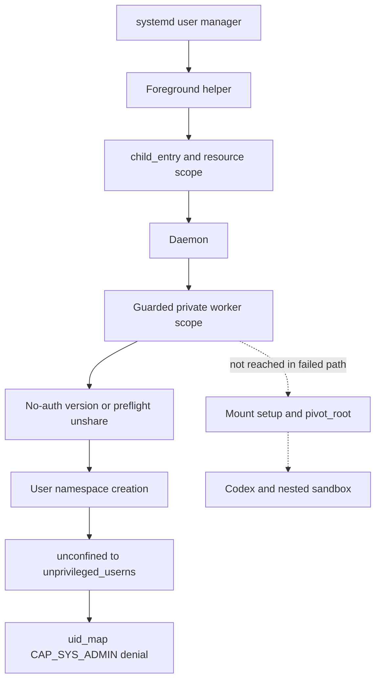

# AppArmor Design Review: Phase 2-E3.1

**Design only. Do not apply or load the draft.** The 2026-10-28/29 investigation began at `35a56c786396ab4540d308e14820d7b0adbf8803` and made no profile load, host-security change, or service start. The [Japanese historical source](apparmor-policy-design_jp.md) preserves the detailed tables, source analysis, and evidence references unchanged. This English explanation separates observations from proposals and unverified behavior.

## Conclusion

Adding only `userns,`, placing generic Python/unshare at a dedicated path, or borrowing an existing permissive profile is not an accepted solution. Option A, an **unprivileged fixed native entry point with setup/payload privilege separation**, is a conditional design candidate, not a working policy for the current launcher. Safe coexistence with Codex/bwrap nested namespaces remains unresolved. Do not broaden capabilities/mounts or disable no_new_privs to call it complete.

Option B, preserving the existing launch model without changing current profiles, had no demonstrated viable solution and was not selected. The [no-auth draft](../systemd/apparmor/agent-orchestrator-noauth.draft) models fixed fixture setup and a closed payload gate only. It grants no Python/Codex execution, implements no native helper, and does not resolve the two E3 failures. It is not ready for a host-installation approval request.

E3's recorded result remains 161 passes and two failures: 148 prior passes plus thirteen of fifteen new checks. E3.1 did not rerun service tests, alter their assertions, or make those failures pass by skipping them.

## Observed environment and source evidence

The original environment used kernel `7.0.0-38-generic` / package `7.0.0-38.38`, AppArmor parser `5.0.2-0ubuntu1~26.04.1`, util-linux `2.41.3-3ubuntu2.2`, bubblewrap `0.11.1-1ubuntu0.3`, and libc `2.43-2ubuntu2.4`. Unshare/bwrap were root-owned, non-setuid. Namespace, AppArmor, and seccomp features were enabled; both unprivileged-userns/unconfined restrictions were 1. Securityfs advertised relevant userns, mount, pivot, and profile operations.

The IDE-origin investigator had `snap.code.code (complain)`. E3's correlated minimal systemd probe transitioned from `unconfined` to `unprivileged_userns`, then failed uid_map write with CAP_SYS_ADMIN denial. It was not a demonstrated failure to create the user namespace itself. Individual worker full-profile stacks were not all measured; the process diagram is reconstructed from implementation, not one simultaneous trace.

Matching Ubuntu-tag kernel source and archive metadata were consulted, without rebuilding to prove binary identity or reviewing every Ubuntu delta in every dependency. Clone/fork paths were identified in source; actual clone3 use through libc/Python/Codex was not traced and must not be assumed absent. Evidence stayed in ignored `.runtime/phase2-e3-1-evidence/`; original E3 logs were not modified. Authentication descriptions came from static code, not reading credentials.

## Existing launch path and denial



A cgroup move does not itself change the AppArmor label. Scope children preserve the caller relationship; a service launched by the user manager differs from an IDE-inherited foreground context. `child_entry` handles parent-death/exec; `resource_entry` validates/monitors resources, not namespaces.

Current isolated launch constructs unshare user/map-root/mount/PID/IPC/fork/proc options, adding net for no-auth. Legacy isolation has a separate remaining path. Unshare writes its own uid_map, then setgroups/gid_map; E3 did not show reaching those later steps. Python mount/bootstrap/pivot operations occur after the observed failure. Setpriv drops most bounding capabilities, but a nested user namespace can regain namespace-scoped capabilities; dropping the outer set alone does not prove nested mounts impossible.

The kernel's `map_write` checks `file_ns_capable(..., CAP_SYS_ADMIN)`, consistent with the denial. Existing `unprivileged_userns` allows namespace creation while auditing/denying capabilities/profile changes and stacking exec labels. Do not change that shared profile.

AppArmor permission does not grant a missing kernel capability. `capability sys_admin` is broad and not qualified as only inside a newly created user namespace in this draft. The entry must reject privileged/host-root callers and validate namespace/UID boundaries. File, mount, exec, DAC, namespace ownership, and capability rules continue independently after creation.

## Option A: proposed native setup and closed gate

The following are **unimplemented design requirements**:

1. Review a root-owned, non-setuid, non-file-capability fixed native `/usr/libexec/agent-orchestrator/ns-entry`, executed by an unprivileged operator. It is not a Python wrapper or copied general unshare. Installation/group access needs separate authorization.
2. Attach setup policy only to that binary. Validate execution/lease IDs, parent boot/PID/start, private cgroup, permitted runtime/session, and fixed operations. Same-UID callers can still invoke the helper; do not claim only the daemon can.
3. Prevent pre-main injection, for example through reviewed static linking; clearing environment in main is too late for LD_PRELOAD. Accept no arbitrary Python/import/shell/exec, mounts, or UID/GID maps.
4. Single-thread namespace setup, own one-line UID/GID maps, fixed mounts, pivot/detach, safe FD-relative path resolution, and revalidation of session/FD ownership. Reject initial privileged callers and carry no host cwd/unneeded FDs forward.
5. Drop setup privilege and require a fixed payload-gate profile transition, failing closed. Check final profile/namespace/capabilities/read-only mounts/no old root or external FDs. Retain parent-death, cgroup supervision, and cleanup receipts. Review negative cases as new trusted code.

The draft SESSION is one `REVIEW_REQUIRED_SESSION` fixture, not a production workspace glob or per-process dynamic binding. Multiple workspaces need individualized profiles or a broader trusted helper/session authorization model, explicitly acknowledging the larger compromise impact. Do not add an unapproved root/profile-loading broker per task.

UID-owner `/proc/@{pid}` rules are not self-PID-only: they can include other same-UID processes. The helper must bind its own proc FDs; policy alone cannot restrict map contents or prove self-only access.

Setup candidate permissions cover userns creation, bounded sys_admin/setpcap needs, own-map access, private propagation, fixed tmpfs/bind/read-only/proc/pivot/detach paths, and mandatory native-gate exec. They do not authorize arbitrary mounts/exec, network/DBus/ptrace, generic capabilities, setuid/setgid/setfcap, or authentication mounts. Tmpfs data/minimal syscall permissions still need helper/seccomp validation. There are no unconfined flags, generic `file,`/`mount,`/`capability,`, `/** rwx`, or unconfined/inheritance exec fallbacks.

## Unresolved blockers and rejected shortcuts

- The closed payload denies capabilities/userns/mounts and cannot run the present Codex/bwrap nested sandbox. A separately proven nested-builder boundary is required, not simply relaxing those denials.
- bwrap sets no_new_privs. Mandatory Px transitions, including inherited NNP and a potentially broader builder, require real subset/stack checks; one profile's allow cannot cancel a stacked deny. Never remove NNP to bypass failure.
- Static parser 5.0.2 rejected `userns create -> profile`. Kernel support for internal transition code is not proof of available policy syntax. Do not depend on pivot_root profile transition either; the inspected kernel returned the original label.
- Actual syscall/FD/mount permission sets, tmpfs data, post-pivot paths, secure-exec, cleanup, auth/legacy paths, dynamic workspaces, and two-way concurrency remain unverified or need implementation changes.
- `ix` on generic Python can leak setup privileges. Paths alone do not authorize argv/script content/workspace ownership. Writable entry/import paths cannot be the trust boundary.

Option B shortcuts failed the design requirements: user-manager `AppArmorProfile=` was unsupported by the cited systemd 259 contract; aa-exec requires loaded policy and does not solve generic-Python exposure; the host bwrap stack denies capabilities needed by the current child setup. Replacing the bootstrap entirely with bwrap would be a different unverified redesign. PrivateUsers/RestrictNamespaces do not turn a denial into permission. Other applications' profiles, root/setuid, weakened sysctl, and unisolated fallback are not accepted alternatives.

## systemd/cgroup compatibility

CPU/memory/task limits grant no permissions and cannot replace AppArmor. Preserve private scopes, receipts, parent-death, and unknown rules. Future RestrictNamespaces/SystemCallFilter/ProtectHome/ProtectSystem changes must be checked against actual setup/auth/runtime needs; broad deny breaks setup and broad privileged allow proves nothing. Clone3 has pointer arguments and cannot be assumed covered by clone-flag filters. No new such settings were applied in E3.1.

## Historical static validation

```bash
apparmor_parser -Q -K --abort-on-error --Werror \
  -o .runtime/phase2-e3-1-evidence/draft.compiled \
  systemd/apparmor/agent-orchestrator-noauth.draft
```

Installed help established that `-Q` avoids kernel loading and `-K` avoids cache reads/writes. The recorded compile exited 0 with zero warnings and 6,568 output bytes in ignored evidence; unsupported transition syntax exited 1. **Syntax success proves neither least privilege nor kernel-enforced runtime success.** No `/etc`/cache/profile load, credential/Codex-DB/daemon-IPC access, service start, or new-namespace trial occurred. Preservation checks retained existing source/test/profile hashes and restriction values; the helper remained absent. These are historical results, not rerun claims from translation.

## Required future approval, validation, and rollback

After design blockers are resolved, seek exact authorization for reviewed helper/gate binaries and updates, final setup/payload/nested profiles and permission rationale, only new dedicated profile placement/load, minimal launcher integration, and dedicated fixture tests. Existing generic profiles/attachments/sysctl stay unchanged; name collisions stop installation. Stage B unit placement/credential migration/manual service launch is a later separate decision.

Begin future validation with approved fixed no-auth, zero-generation fixtures. Correlate allowlisted PID/executable/profile stacks, namespace inodes, capabilities, NNP, cgroup, and each setup phase without full environment/credential dumps. Negative tests must reject wrong users/groups/runtime, symlink/mount/FD/environment injection, arbitrary exec/mounts, foreign sessions/old root, and privilege-regaining transitions. Validate nested NNP behavior separately, then rerun the original 148 plus fifteen E3 tests without skips/assertion weakening. Demonstrate RUNNING/turn before SIGTERM/SIGKILL injection, cleanup/cancellation/unknown/queued preservation, and no replay. Preserve and diagnose recurring EOF instead of reporting only a successful retry.

Nothing was applied in E3.1, so no host rollback was needed. Future rollback stops only authorized fixture work and confirms PID/start/namespace/cgroup/profile release before an administrator removes only newly installed profiles/binaries and restores reviewed launcher code. Do not unload an active profile casually, potentially leaving processes unconfined. Uncertain remnants stop rollback for administrator judgment, not OS reboot/unrelated-daemon stopping. Preserve runtime/DB/logs/unknown evidence and never reset tasks to queued.

References: [Ubuntu kernel user namespaces](https://git.launchpad.net/~ubuntu-kernel/ubuntu/+source/linux/+git/resolute/tree/kernel/user_namespace.c?h=Ubuntu-7.0.0-38.38), [AppArmor LSM](https://git.launchpad.net/~ubuntu-kernel/ubuntu/+source/linux/+git/resolute/tree/security/apparmor/lsm.c?h=Ubuntu-7.0.0-38.38), [parser userns](https://gitlab.com/apparmor/apparmor/-/blob/v5.0.2/parser/userns.cc), [bwrap v0.11.1](https://github.com/containers/bubblewrap/blob/v0.11.1/bubblewrap.c), and [systemd namespace controls](https://www.freedesktop.org/software/systemd/man/259/systemd.exec.html#RestrictNamespaces=).
