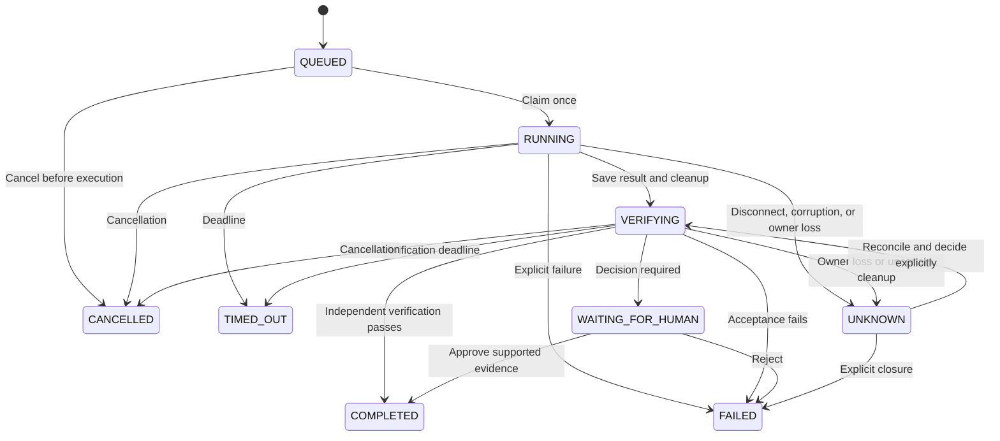

# Runtime Architecture

This explanation covers the Phase 2-D2 runner architecture. Later adapters and native-team work build on it; this phase description is not a claim that every deployment path is currently verified. The [Japanese historical source](architecture_jp.md) is preserved unchanged.

The runtime uses a dedicated App Server stdio process, the Python 3.14 standard library, and owned SQLite state. Legacy shared-workspace execution remains serial; isolated workspaces permit at most two sessions in one runtime. Execution, acceptance verification, and recovery decisions are separate.

| Module | Responsibility |
| --- | --- |
| `runner.py` | CLI, per-task execution, Codex control, handoff to `VERIFYING` |
| `concurrency.py`, `coordinator.py` | Two slots, task/workspace leases, foreground workers |
| `workspaces.py`, `isolated_entry.py` | Fixtures, ownership, snapshots, minimal-root `pivot_root` |
| `storage.py` | Owned database, migrations, IDs, states, evidence, decisions |
| `recovery.py` | Resource, session, and side-effect reconciliation; explicit decisions |
| `verification.py` | Acceptance criteria, statically allowed commands, workspace boundaries |
| `transport.py` | JSONL/RPC, pending notifications, logs, owned-process cleanup |
| `isolation.py`, `ns_entry.py` | Read-only boundaries, authentication/workspace isolation, reduced privileges |
| `resources.py`, `resource_entry.py` | Private cgroup scopes, hard per-file limits, budget monitoring, durable receipts |
| `retention.py` | Storage inventory and protected tasks; no deletion |
| `child_entry.py` | Parent-death handling without `preexec_fn` |

## Execution lifecycle

1. Persist the objective, acceptance criteria, and allowed-argv snapshot as `QUEUED`.
2. Under the appropriate leases, record abandoned `RUNNING`/`VERIFYING` work as `UNKNOWN`. Do not rerun it.
3. Claim with a conditional update. In the same transaction, record a distinct `execution_id`, owner boot/PID/start identity, and pre-execution manifest.
4. Save pre-launch and post-launch checkpoints; check initialization, authentication, and sandbox settings.
5. For resume, reconcile history, latest turn, resources, and manifest before opening the execution server, avoiding overlapping servers.
6. Persist turn-send intent, then monitor IDs, events, and states.
7. Save the Codex result and cleanup evidence; send a normal result to `VERIFYING`.
8. Verify artifacts, tests, and task-specific conditions. Commit evidence with the final state, or wait for a human decision.

There is no automatic `UNKNOWN` to `QUEUED`/`RUNNING` transition. Conversation resume is a separate submission with a new task/execution. `COMPLETED` means the defined criteria passed, not universal semantic correctness.

## Persistence and boundaries

Schema v3 separates tasks, executions, transitions, reconciliations, verifications, decisions, workspaces, and snapshots. Logs carry task/execution/thread IDs; important turn and cleanup records are flushed and fsynced. A valid-looking JSON tail without a newline is a truncated record, not a completed event.

Only the runner's own `tasks.sqlite` is directly managed. Reconciliation uses official APIs without `turn/start`. Existing authentication is mounted read-only; the original `CODEX_HOME` is hidden; HOME is read-only; runtime/tmpfs and the Codex sandbox remain separate. Existing daemons and IPC are not used. Boot/PID/start identity prevents treating a reused PID as an owned process. Missing launch checkpoints never prove cleanup.

Artifacts are restricted to the owned workspace; verification commands come from a static allowlist. See [workspace isolation](workspace-isolation.md), [verification](verification-design.md), [recovery](recovery-design.md), and [concurrency](concurrency-design.md).

## Resources and the persistent daemon

App Server, probes, and verifiers enter private systemd user scopes. Effective values are checked before namespace children start. Cleanup reconciles both cgroups and PID/start identity. Resource policy and receipt references use existing schema-v3 JSON fields rather than remigrating old rows. See [resource limits](resource-limits.md) and [retention](retention-policy.md).

`daemon.py` owns the Unix-socket/worker event loop, `scheduler.py` owns one-shot reservations/FIFO/recovery, and `control_socket.py` validates peer UID and bounded JSONL. Existing runners still execute and verify tasks. Worker exit codes alone never establish task success. Additional tables persist pause, timeout, and dispatch ownership; see [daemon](daemon-design.md), [scheduler](scheduler-design.md), and the [D2 report](phase2-d2-report.md).

The Phase 2-D2 scope excluded more than two concurrent sessions, local LLMs, ChatGPT/MCP connections, and public exposure. Those historical exclusions do not describe the status of later separately documented adapters.
