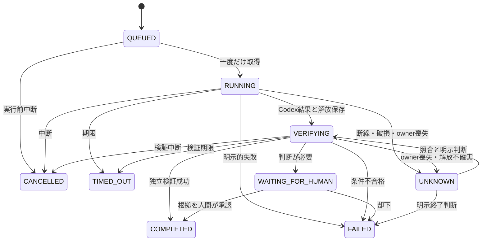

# Phase 2-D2 アーキテクチャ

専用App Server stdio、Python 3.14標準ライブラリ、既存の単一workspace実行を保ち、専用workspaceでは最大2セッションを許可する。
実行完了、受入検証、復旧判断を分離した。新しいSDK・HTTPサーバー・daemon・backend抽象化は導入しない。

| モジュール | 責務 |
| --- | --- |
| runner.py | CLI、タスク単位の実行、Codex制御、VERIFYINGへの引渡し |
| concurrency.py / coordinator.py | 2 slot・タスク／workspace lease、前景worker管理 |
| workspaces.py / isolated_entry.py | fixture・所有権・スナップショット、最小rootへのpivot_root |
| storage.py | 所有DB、移行・復元、ID、状態、根拠・判断の永続化 |
| recovery.py | 資源・セッション・副作用の照合と明示判断 |
| verification.py | 受入条件、静的許可コマンド、workspace境界 |
| transport.py | JSONL/RPC、通知保留、ログ、所有プロセス解放 |
| isolation.py / ns_entry.py | read-only、認証・作業領域隔離、権限縮小 |
| resources.py / resource_entry.py | 専用cgroup scope、hard file limit、予算監視、永続receipt |
| retention.py | 保存量と保護taskの確認。削除処理なし |
| child_entry.py | 親死亡時の停止。preexec_fnは使わない |

## 実行

1. 目的と受入条件、許可済みargvのsnapshotをQUEUEDとして保存する。
2. ロック下で不完全なRUNNING/VERIFYINGをUNKNOWNへ記録する。再実行しない。
3. taskを条件付きUPDATEで取得し、別execution_id、ownerのboot/PID/start、実行前manifestを同じトランザクションで保存する。
4. 起動前markerと起動後の識別情報を保存し、初期化・認証・sandboxを確認する。
5. resumeの履歴・最新turn・資源・manifestは実行serverを開く前に照合する（同時server増加を防止）。
6. turn送信意図を永続化し、ID・イベント・状態を監視する。
7. Codex結果と解放を保存し、正常結果をVERIFYINGへ移す。
8. 成果物・テスト・固有条件を検証し、根拠と最終状態を同じトランザクションに保存する。必要なら人間判断を待つ。

UNKNOWNからQUEUED/RUNNINGへの自動遷移はない。会話再開は新しいtask/executionを投入する別操作。
COMPLETEDは定義された条件の合格であり、任意の目的への万能な意味的正しさの保証ではない。

## 永続化と境界

schema v3はtasks、executions、transitions、reconciliations、verifications、decisions、workspaces、snapshotsを分ける。
ログにtask/execution/threadを付け、重要なturn送受信とcleanupをflush/fsyncする。
末尾がvalid JSONに見えても改行がなければ完了イベントとせず、切断を記録する。
直接操作するのはランナー自身のtasks.sqliteだけ。照合は公式APIを使い、turn/startを呼ばない。

既存認証read-only mount、元CODEX_HOMEの隠蔽、read-only HOME、専用runtime/tmpfs、Codex sandboxを維持する。
既存daemon・IPCへ接続しない。PID/start/bootを区別し、再利用PIDを他者のプロセスと誤認しない。
親死亡guardとPID namespaceで親停止に備え、起動checkpoint不足は解放済みと推測しない。
検証対象ファイルはworkspace内、コマンドは静的許可リストだけ。詳細は個別設計書を参照。

## スコープ

Phase 2-D2まで。3以上の並行セッション、ローカルLLM、ChatGPT/MCP接続、外部公開は追加しない。
新しいisolatedモードの境界・snapshot・復旧については[Workspace隔離](workspace-isolation.md)と[並列設計](concurrency-design.md)を参照。

- [復旧・移行設計](recovery-design.md)
- [完了判定設計](verification-design.md)
- [実施報告](phase2-ab-report.md)

## 資源と容量

専用systemd user scope内にApp Server・probe・verifierを起動し、実効値を検証してからnamespace子へ進む。
新しいscopeと既存の親死亡guardを組み合わせ、CG解放とPID/startの両方を照合する。
schema v3のowner／cleanup JSONへpolicyとreceipt参照を追加するため、旧行・旧schemaを再移行しない。
[資源制限](resource-limits.md)、[保持方針](retention-policy.md)、[D1報告](phase2-d1-report.md)を参照。

## 永続daemon

daemon.pyはUnix socketとworkerのイベントループ、scheduler.pyは一回限り予約・FIFO・回復、control_socket.pyはpeer UIDと有限JSONLを担当する。
既存runnerが実行・検証を担当し、daemonはworker終了コードだけで成功を作らない。
core schema v3に追加表を作り、pause／timeout／dispatch所有を保存する。
[daemon設計](daemon-design.md)、[scheduler設計](scheduler-design.md)、[D2報告](phase2-d2-report.md)を参照。
